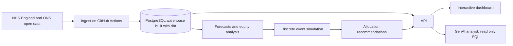

# MentalScape 2.0

**Decision support for NHS mental health service planning in England, from open data to recommendation.**

[](https://github.com/nbennwankwo/MentalScape-2.0/actions/workflows/ci.yml)


## Why this exists

Mental health services in England are under pressure, and the pressure is uneven. The people who decide where money and staff go, in Integrated Care Boards, NHS trusts and public health teams, mostly see what happened last month. They rarely see what is likely to happen next, why one area differs from another, or what a change would actually do to waiting times.

NHS England publishes a great deal of relevant data every month. It is large, it changes shape over time, and much of it is suppressed at small geographies. MentalScape 2.0 turns it into something a planner can use.

## What it will do

1. **Collect** the right NHS England and ONS files automatically every month
2. **Store** them in a tested SQL warehouse (PostgreSQL and dbt)
3. **Forecast** demand for every area, always compared against a simple baseline
4. **Simulate** service pathways to test changes before committing money
5. **Recommend** allocations that balance waiting times, cost and fairness
6. **Explain** results in an interactive dashboard and a question answering assistant that only answers from the data

Every feature traces back to a question that a real decision maker asks. See [who it is for](docs/01_decision_makers.md).

## Where the project is now

**Phase 0, foundations, is complete, and Phase 1, data engineering, is well under way.** Every MHSDS monthly file since July 2022 is now collected automatically, checksummed and loaded into a tested dbt warehouse that runs on DuckDB locally and PostgreSQL in CI. The [pipeline guide](docs/data/pipeline.md) explains each step, and the [roadmap](docs/03_roadmap.md) shows every phase and its status.

The first piece of real analysis is a full history of the source data. The [MHSDS change log](docs/data/mhsds_change_log.md) profiles every monthly release of the Mental Health Services Monthly Statistics from July 2022 to August 2026, and records every measure, breakdown and geography change, with what each one means for modelling.

## How the data changed, in brief

- The publication grew from **247 measures in July 2022 to 399 in August 2026**, and from 49 to 110 breakdowns.
- Most change happens in **April**, at the start of each financial year. April 2023 added 90 measures, and April 2024 brought **MHSDS version 6**, which removed 9 measures and renamed 7.
- From **1 April 2026, twelve ICBs merged into six**, taking England from 42 ICBs to 36. Most Sub ICB codes survived, which is why this project uses the Sub ICB as its stable building block.
- About **four in five published values are suppressed**, and that share has barely moved since 2022.
- Some jumps in the data are **method changes**, such as attended community contacts (MHS30f) in April 2024 and May 2025. Others are **real seasonal patterns**, such as children's referrals falling by about 40 percent every August.

The full story, month by month, is in the [change log](docs/data/mhsds_change_log.md).

## Architecture



The full design and the reasons behind each choice are in [architecture](docs/02_architecture.md) and the [decision records](docs/adr/).

## Repository layout

```
config/            data source register
data/reference/    small committed reference tables (raw data is never committed)
docs/              charter, users, architecture, roadmap, data, decisions, research
src/mentalscape/   Python package
tests/             tests that run in CI on every change
warehouse/         the dbt project, with models, macros, seeds and data tests
tools/             the browser script that lists NHS England's release files
sql/               exploration queries
notebooks/         exploration only, outputs stripped
```

## Getting started

You need [uv](https://docs.astral.sh/uv/) and git.

```
git clone https://github.com/nbennwankwo/MentalScape-2.0.git
cd MentalScape-2.0
make setup
make check
```

To build the warehouse from every real month, run `make warehouse`. It downloads the collected files from the project's data release, checks their checksums and builds a DuckDB file at `data/warehouse/mentalscape.duckdb`. No database server is needed. `make warehouse-fixture` does the same on a small synthetic dataset in seconds.

To rebuild the change log, put MHSDS main data files in `data/raw/mhsds_monthly/` and run `make profile` then `make changelog`.

## Documentation

| Read this | To learn |
|---|---|
| [Project charter](docs/00_project_charter.md) | the problem, scope and what success looks like |
| [Decision makers](docs/01_decision_makers.md) | who it is for and the questions they ask |
| [Architecture](docs/02_architecture.md) | how the pieces fit together |
| [Roadmap](docs/03_roadmap.md) | what is done and what comes next |
| [Data sources](docs/04_data_sources.md) | where the data comes from and its limits |
| [Data governance](docs/05_data_governance.md) | how the data is handled |
| [Ways of working](docs/06_ways_of_working.md) | how the project is run |
| [MHSDS change log](docs/data/mhsds_change_log.md) | how the source data changed from 2022 to 2026 |
| [MentalScape 1.0 audit](docs/legacy/mentalscape_1_audit.md) | what was kept from the dissertation and what was fixed |

## Background

MentalScape 1.0 was an MSc Data Science dissertation at Loughborough University (Distinction, 2025). It integrated machine learning, discrete event simulation and socioeconomic data across 106 Sub ICBs. MentalScape 2.0 keeps its questions and rebuilds the answers with reproducible engineering and stricter validation. The [audit](docs/legacy/mentalscape_1_audit.md) explains what changed and why.

## Data and licence

Code is released under the [MIT licence](LICENSE). The project uses only published aggregate statistics. Contains public sector information licensed under the Open Government Licence v3.0, from NHS England and the Office for National Statistics. No patient level data is held.

## Author

Nkemjika (Kemi) Ben-Nwankwo, London. Built with Claude as an engineering collaborator.
