# Target architecture

This is the design the project is building towards. Each box is delivered in a phase of the [roadmap](03_roadmap.md). Choices marked **proposed** are recorded as decision records and can still change.

```mermaid
flowchart LR
    subgraph Sources["Open sources"]
        S1[MHSDS Monthly Statistics]
        S2[NHS Talking Therapies monthly]
        S3[Indices of Deprivation 2025]
        S4[ONS population and lookups]
        S5[NHS workforce statistics]
    end

    subgraph Ingest["Ingest, monthly on GitHub Actions"]
        I1[Find new release pages]
        I2[Download and checksum]
        I3[Manifest of every file and version]
    end

    subgraph Warehouse["PostgreSQL warehouse, modelled with dbt"]
        W1[(raw)]
        W2[(staging, cleaned and typed)]
        W3[(marts, analysis ready)]
        W4[data tests]
    end

    subgraph Analytics["Models"]
        A1[Demand forecasts]
        A2[Equity and peer groups]
        A3[Discrete event simulation]
        A4[Allocation optimiser]
    end

    subgraph Serve["Serving"]
        V1[API]
        V2[Interactive dashboard]
        V3[GenAI analyst, read only SQL]
    end

    Sources --> I1 --> I2 --> I3 --> W1 --> W2 --> W3
    W4 -.checks.-> W2
    W4 -.checks.-> W3
    W3 --> A1 & A2 & A3
    A1 --> A3 --> A4
    A2 --> A4
    W3 --> V1
    A1 & A2 & A3 & A4 --> V1
    V1 --> V2
    V1 --> V3
```

## Layers in plain words

**1. Ingest.** A scheduled job on GitHub Actions checks the NHS England and ONS publication pages each month, downloads any new or reissued files, records a checksum and the release version, and lands them untouched. GitHub's servers have open internet access, which the local development sandbox does not, so automation runs there by design ([ADR 0007](adr/0007-automation-runs-in-github-actions.md)).

**2. Warehouse.** Files are loaded into PostgreSQL in three layers. *Raw* is an exact copy. *Staging* cleans and types the data, harmonises geography codes and labels, and resolves release versions. *Marts* hold the tables that models and dashboards read. Transformations are written in SQL with dbt so that every step is versioned, documented and tested ([ADR 0002](adr/0002-sql-warehouse-postgres-and-dbt.md)). DuckDB is used locally for fast profiling and prototyping, with the same SQL.

**3. Data tests.** Every load checks the things the change log has shown can go wrong. Examples include an unexpected new measure ID, a missing Sub ICB, a date in a new format, a jump in an England total, or a status label with a trailing space.

**4. Models.**
- *Forecasts* per area and measure, always compared against a seasonal baseline, with school term and financial year effects.
- *Equity* analysis using the deprivation and ethnicity breakdowns that the publication now provides, plus the Indices of Deprivation 2025.
- *Discrete event simulation* of service pathways, calibrated from published waiting time and activity measures and validated on held out months before use.
- *Optimiser* that searches for allocations balancing waits, cost and fairness.

**5. Serving.** A small API exposes model outputs. An interactive dashboard lets a planner explore areas, run scenarios and read recommendations. A GenAI analyst answers questions in plain English by writing read only SQL against approved tables and always shows the query and the source release.

## Proposed tools

| Need | Tool | Status |
|---|---|---|
| Language | Python 3.12 | proposed |
| Environment and packaging | uv | proposed |
| Local analytics engine | DuckDB | in use |
| Warehouse | PostgreSQL | proposed |
| SQL transformations and tests | dbt | proposed |
| Scheduling | GitHub Actions | proposed |
| Experiment tracking | MLflow | to decide in Phase 2 |
| Simulation | SimPy | to decide in Phase 3 |
| API | FastAPI | to decide in Phase 4 |
| Dashboard | Plotly Dash or Streamlit | to decide in Phase 4 |
| GenAI analyst | Claude via the Anthropic API with tool use | to decide in Phase 5 |
| Hosting | to decide in Phase 4 | open |
