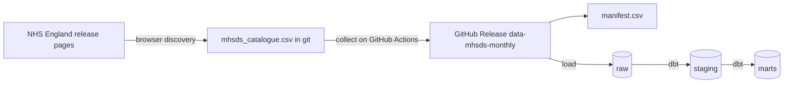

# How the data pipeline works

This page explains, step by step, how NHS England's files become tables that models and dashboards can use. It grows with each part of Phase 1.

## The big picture



## Step 1, discover

NHS England's release pages challenge cloud servers with a bot check, while its file server does not. So discovery happens in a normal browser and collection happens on GitHub Actions ([ADR 0011](../adr/0011-split-discovery-from-collection.md)).

**How to refresh the catalogue**, about once a month after NHS England publishes a new release.

1. Open the [series page](https://digital.nhs.uk/data-and-information/publications/statistical/mental-health-services-monthly-statistics) in a browser.
2. Run [`tools/discover_in_browser.js`](../../tools/discover_in_browser.js) in the browser's developer console. It reads every release page from 2022 onwards and saves `mhsds_cards.json`.
3. Run `uv run python -m mentalscape.ingest.mhsds classify --cards mhsds_cards.json`.
4. Open a pull request with the updated `data/reference/mhsds_catalogue.csv`. Once it is merged, collection starts by itself.

A download card is the box on a release page that holds one file, its title, its type and its size. Each card title is classified into four things.

| Field | Example | How it is found |
|---|---|---|
| kind | `main`, `oaps`, `referral_spells`, `dq_coverage`, `dq_vodim` | key phrases such as "MHSDS Data File" or "Out of Area Placements" |
| version | `final`, `performance`, `provisional` | "End of Year Final", "Performance", "Provisional" (and the real misspelling "Provsional") |
| reporting month | `2025-08` | the first month named, or the last month for files that cover a range |
| revision | `1`, `2`, `4` | "V4" in the title or "_v2" in the file name |

The rules were written against all 1,426 card titles published from 2022 to 2026, and the tests use real titles. NHS England's card titles occasionally carry a typo. When the title's month disagrees with both the page and the file name, and those two agree, the page and file name win and the `note` column records the correction. Four such typos were found in October 2026.

The result is [`data/reference/mhsds_catalogue.csv`](../../data/reference/mhsds_catalogue.csv), one row per file, including the files the pipeline does not want and the reason why. Because it is committed to git, every change NHS England makes to its releases shows up as a reviewable diff.

## Step 2, collect

Every wanted file in the catalogue whose web address is not already in the manifest is downloaded from `files.digital.nhs.uk`, with a one second pause between requests to be polite to NHS England's servers. Each file is

1. checksummed with SHA-256, so any later change can be detected
2. gzipped if it is a CSV, which shrinks older uncompressed files by about ten times
3. given an asset name such as `mhsds__main__2025-08__final__r1__3f2a9c1d0b.zip`
4. added as a row in `manifest.csv`

The wanted kinds and versions are set in [`config/sources.yaml`](../../config/sources.yaml). Today they are the main data file, out of area placements, referral spells and the two data quality files, in both End of Year Final and Performance versions.

## Step 3, publish

The `Ingest MHSDS` GitHub Actions workflow runs every Friday morning and can also be run by hand. It runs whenever the catalogue changes on `main`, and its weekly run also fails if the catalogue is more than three months behind, as a reminder to refresh it. It uploads new files, the manifest and the catalogue to the [`data-mhsds-monthly`](https://github.com/nbennwankwo/MentalScape-2.0/releases/tag/data-mhsds-monthly) release ([ADR 0009](../adr/0009-raw-files-in-github-release-assets.md)). On a pull request it does a trial run of two files and publishes nothing.

## Choosing one file per month

Most months now have two versions of each file. The rule in [ADR 0003](../adr/0003-time-window-and-release-versions.md) is applied by `preferred_files` in `src/mentalscape/ingest/manifest.py`.

1. End of Year Final beats Performance, which beats Provisional.
2. Within a version, the highest revision wins.
3. If there is still a tie, the most recent download wins.

The raw layer keeps every version. Only the choice of which one to use is made here.

## Step 4, load into the warehouse

`mentalscape.warehouse.fetch` downloads the preferred file of every month from the data release and checks each checksum. `mentalscape.warehouse.load` then puts every row into the `raw` schema exactly as published, with every value still text, plus columns saying which file it came from. Before loading, each file is unzipped or ungzipped, its header is checked against the eleven expected columns, and files that mix Windows and Unix line endings are read from a normalised copy.

The warehouse runs on two databases with the same SQL ([ADR 0010](../adr/0010-duckdb-locally-postgresql-in-ci.md)).

| Where | Database | Data |
|---|---|---|
| Your laptop | DuckDB, a single file at `data/warehouse/mentalscape.duckdb` | all real months |
| Every pull request | PostgreSQL 16 | the synthetic fixture |
| Production, from Phase 4 | PostgreSQL | all real months |

## Step 5, build with dbt

The dbt project in [`warehouse/`](../../warehouse) turns raw text into analysis ready tables in three layers.

| Layer | Model | One row per |
|---|---|---|
| staging | `stg_mhsds__values` | published value, typed, with all five date styles parsed and the geography label mapped to one of six levels |
| staging | `stg_mhsds__files` | collected file and version |
| intermediate | `int_geo__sub_icb_monthly` | Sub ICB and month, with the ICB it belonged to that month |
| marts | `fct_mhsds_values` | value, keyed on release month, reporting window, breakdown, area, category and measure |
| marts | `dim_mhsds_measure` | measure ID, with first and last month, windows used and any NHS England caveat |
| marts | `dim_mhsds_release` | month, with the file and version used and how many values it gave |
| marts | `geo_sub_icb_membership` | unbroken run of months in which a Sub ICB belonged to one ICB |
| marts | `dim_sub_icb` and `dim_icb` | code ever published, with its latest name and whether it is current or retired |

**How the ICB of a Sub ICB is worked out.** Sub ICB names include their ICB, for example "NHS ESSEX ICB - 06Q". Some final files give a code two names, one from before the April 2026 mergers and one from after. For each month, the name whose ICB really appears in that month's ICB rows is the one used. This is why 06Q sits under Mid and South Essex until March 2026 and under Essex from April 2026, even though the earlier files already carry the new name.

**One month needs a fallback.** The March 2026 End of Year Final file was produced after the mergers. It gives 23 Sub ICBs only their new names, while its ICB rows are still the old 42 ICBs, so no name matches. For those rows the ICB from the Sub ICB's previous release is used, and the column `icb_source` says "carried forward from previous month". The membership table counts these months in `months_carried_forward`, so the fallback is always visible and never hidden. Only one release is ever carried, so a longer gap stays unmatched and the test below warns.

**SQL that differs between the two databases** lives in one file, [`warehouse/macros/cross_database.sql`](../../warehouse/macros/cross_database.sql). It covers pattern matching and the parsing of dates and numbers. Every model calls those macros, so the models are identical on both databases.

## Step 6, test

Every build runs data tests. Each one comes from something the [change log](mhsds_change_log.md) found in the real files.

| Test | Guards against |
|---|---|
| period dates are never null | a new date style appearing |
| status is one of Final, Performance, Adhoc or Provisional | a new or misspelt status label |
| reporting window is 1, 3 or 12 months | a new kind of rolling window |
| values are unique on release, window, breakdown, area, category and measure | double counting, for example of MHS32's two windows |
| every measure in the fact table is in the measure dimension | broken joins |
| no file holds values for periods after its own month | a misclassified file |
| every release has at least 100 Sub ICBs | a broken file or geography mapping |
| release months run without gaps | a missing download |
| every Sub ICB is matched to an ICB, by name or carried forward one release (warning) | a new naming pattern |
| how each Sub ICB's ICB was found is one of three known methods | a silent change to the matching rule |
| every measure ID is one the change log has already seen (warning) | new measures arriving unannounced, the signal to run `make changelog` |
| England values that jump by more than half in a month (warning) | method changes, though many are real seasonal patterns |

## How to run it yourself

```
make setup               # once, installs everything including dbt
make warehouse-fixture   # small synthetic build, takes seconds
make warehouse           # full build from the data release, all real months
```

The full build needs no database server. The result is one DuckDB file you can open in Python, in the DuckDB command line, or in tools such as DBeaver.
