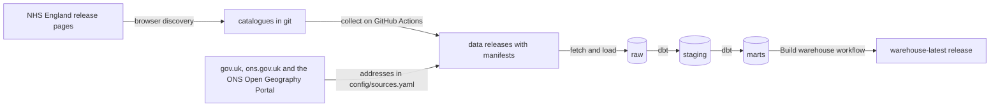

# How the data pipeline works

This page explains, step by step, how published files from NHS England, ONS and MHCLG become tables that models and dashboards can use. It covers every Phase 1 source.

| Source | Publisher | How it is found | Data release |
|---|---|---|---|
| Mental Health Services Monthly Statistics (MHSDS) | NHS England | browser discovery, then a catalogue in git | [`data-mhsds-monthly`](https://github.com/nbennwankwo/MentalScape-2.0/releases/tag/data-mhsds-monthly) |
| NHS Talking Therapies monthly statistics, including the IAPT years | NHS England | browser discovery, then a catalogue in git | [`data-talking-therapies-monthly`](https://github.com/nbennwankwo/MentalScape-2.0/releases/tag/data-talking-therapies-monthly) |
| Indices of Deprivation 2025, ONS LSOA population estimates, ONS geography lookups | MHCLG and ONS | fixed addresses listed in `config/sources.yaml` | [`data-reference`](https://github.com/nbennwankwo/MentalScape-2.0/releases/tag/data-reference) |

## The big picture



## Step 1, discover

NHS England's release pages challenge cloud servers with a bot check, while its file server does not. So discovery happens in a normal browser and collection happens on GitHub Actions ([ADR 0011](../adr/0011-split-discovery-from-collection.md)). The reference files do not need this step, because each one has a fixed address.

**How to refresh a catalogue**, about once a month after NHS England publishes a new release. Do it once for each series.

1. Open the series page in a browser, either [MHSDS](https://digital.nhs.uk/data-and-information/publications/statistical/mental-health-services-monthly-statistics) or [NHS Talking Therapies](https://digital.nhs.uk/data-and-information/publications/statistical/nhs-talking-therapies-monthly-statistics-including-employment-advisors).
2. Run [`tools/discover_in_browser.js`](../../tools/discover_in_browser.js) in the browser's developer console. It works out which series it is on, reads every release page from 2022 onwards, including the older IAPT series page for Talking Therapies, and saves `mhsds_cards.json` or `talking_therapies_cards.json`.
3. Run `make catalogue CARDS=mhsds_cards.json` or `make catalogue-tt CARDS=talking_therapies_cards.json`.
4. Open a pull request with the updated catalogue in `data/reference/`. Once it is merged, collection starts by itself.

A download card is the box on a release page that holds one file, its title, its type and its size. Each card title is classified into four things.

| Field | MHSDS example | Talking Therapies example | How it is found |
|---|---|---|---|
| kind | `main`, `oaps`, `referral_spells` | `activity`, `dq` | key phrases such as "MHSDS Data File" or "Monthly Activity Data File" |
| version | `final`, `performance` | `final`, `performance` | "End of Year Final", "Final", "Performance", and for early versions "Provisional", "Primary" and the real misspelling "Provsional" |
| reporting month | `2025-08` | `2023-06` | the first month named, or the last month for files that cover a range |
| revision | `1`, `2`, `4` | `2` | "V4" or "v2" in the title, or "_v2" in the file name |

The rules were written against every card title published from 2022 to 2026, 1,426 for MHSDS and 380 for Talking Therapies, and the tests use real titles. NHS England's card titles occasionally carry a typo. When the title's month disagrees with both the page and the file name, and those two agree, the page and file name win and the `note` column records the correction.

The results are [`data/reference/mhsds_catalogue.csv`](../../data/reference/mhsds_catalogue.csv) and [`data/reference/talking_therapies_catalogue.csv`](../../data/reference/talking_therapies_catalogue.csv), one row per file, including the files the pipeline does not want and the reason why. Because they are committed to git, every change NHS England makes to its releases shows up as a reviewable diff.

## Step 2, collect

Every wanted file whose web address is not already in the manifest is downloaded, with a one second pause between requests to be polite to the servers. Each file is

1. checksummed with SHA-256, so any later change can be detected
2. gzipped if it is a CSV, which shrinks older uncompressed files by about ten times
3. given an asset name such as `mhsds__main__2025-08__final__r1__3f2a9c1d0b.zip` or `reference__iod_2025_file7__2025-10__published__r1__b1b716aa2e.csv.gz`
4. added as a row in `manifest.csv`

The wanted kinds and versions are set in [`config/sources.yaml`](../../config/sources.yaml). For MHSDS they are the main data file, out of area placements, referral spells and the two data quality files. For Talking Therapies they are the activity file and the data quality file. Both take End of Year Final and Performance versions, and never Provisional or Primary ones.

Reference files are listed under `reference_files` in the same register, each with an id, an edition and an address ([ADR 0012](../adr/0012-collect-talking-therapies-and-reference-files.md)). A new edition gets a new entry, so older builds can always be repeated. The collector rejects a download that looks like an error page or lacks the expected header.

## Step 3, publish

Three GitHub Actions workflows do the collecting.

| Workflow | Runs | Publishes to |
|---|---|---|
| `Ingest MHSDS` | Fridays, when the catalogue changes on `main`, and by hand | `data-mhsds-monthly` |
| `Ingest NHS Talking Therapies` | Fridays, when the catalogue changes on `main`, and by hand | `data-talking-therapies-monthly` |
| `Ingest reference files` | Mondays, when `config/sources.yaml` changes on `main`, and by hand | `data-reference` |

The weekly MHSDS and Talking Therapies runs also fail if their catalogue is more than three months behind, as a reminder to refresh it. On a pull request each workflow does a trial run on a few files and publishes them only to the `data-staging` prerelease, so real files can be checked before a change is merged. The warehouse never reads the staging release.

## Choosing one file per month

Most months have two versions of each file. The rule in [ADR 0003](../adr/0003-time-window-and-release-versions.md) is applied by `preferred_files` in `src/mentalscape/ingest/manifest.py`.

1. End of Year Final beats Performance, which beats Provisional.
2. Within a version, the highest revision wins.
3. If there is still a tie, the most recent download wins.

The raw layer keeps every version. Only the choice of which one to use is made here. In October 2026 this picked 50 MHSDS files, 45 of them Final, and 50 Talking Therapies files, 11 of them Final.

## Step 4, load into the warehouse

`mentalscape.warehouse.fetch` downloads the preferred file of every month, and every reference file, from the data releases into `data/raw/<release>/` and checks each checksum. `mentalscape.warehouse.load` then puts every row into the `raw` schema exactly as published, with every value still text, plus columns saying which file, and for workbooks which sheet, it came from.

| Raw table | From |
|---|---|
| `raw.mhsds_main`, `raw.mhsds_files` | MHSDS main data files and their manifest |
| `raw.talking_therapies_activity`, `raw.talking_therapies_files` | Talking Therapies activity files and their manifest |
| `raw.ref_<id>`, `raw.reference_files` | one table per reference file, named after its id in `config/sources.yaml` |

Before loading, each file is unzipped or ungzipped, and files that mix Windows and Unix line endings are read from a normalised copy. MHSDS headers are checked against the eleven expected columns. Other files take their column names from their own header, made safe for SQL, so "LSOA code (2021)" becomes `lsoa_code_2021`. The ONS population workbook has a cover sheet, notes and one sheet per year with title rows above the table, so each sheet that holds a table starting with "LAD 2023 Code" is read from that row down.

The warehouse runs on two databases with the same SQL ([ADR 0010](../adr/0010-duckdb-locally-postgresql-in-ci.md)).

| Where | Database | Data |
|---|---|---|
| Your laptop | DuckDB, a single file at `data/warehouse/mentalscape.duckdb` | all real data |
| The `Build warehouse` workflow | DuckDB | all real data, published as `warehouse-latest` |
| Every pull request | PostgreSQL 16 | the synthetic fixture |
| Production, from Phase 4 | PostgreSQL | all real data |

## Step 5, build with dbt

The dbt project in [`warehouse/`](../../warehouse) turns raw text into analysis ready tables in three layers.

### MHSDS

| Layer | Model | One row per |
|---|---|---|
| staging | `stg_mhsds__values` | published value, typed, with all five date styles parsed and the geography label mapped to one of six levels |
| staging | `stg_mhsds__files` | collected file and version |
| marts | `fct_mhsds_values` | value, keyed on release month, reporting window, breakdown, area, category and measure |
| marts | `dim_mhsds_measure` | measure ID, with first and last month, windows used and any NHS England caveat |
| marts | `dim_mhsds_release` | month, with the file and version used and how many values it gave |

### NHS Talking Therapies

| Layer | Model | One row per |
|---|---|---|
| staging | `stg_talking_therapies__values` | published value, typed, with its geography level, statistic and organisation codes sorted out |
| staging | `stg_talking_therapies__files` | collected file and version |
| marts | `fct_talking_therapies_values` | value, keyed on release month, the two organisation slots and measure, with the ICB of each Sub ICB |
| marts | `dim_talking_therapies_measure` | measure ID, with its statistic, lifetime and number of names |
| marts | `dim_talking_therapies_release` | month, with the file and version used, values and Sub ICBs |

**How the files are laid out.** The IAPT files from 2022 and the NHS Talking Therapies files since May 2023 share the same ten columns. Each row has two organisation slots. The first holds England, a commissioning region or a Sub ICB, the second holds a provider, and "all" fills a slot that is not used. `GROUP_TYPE` says which slots are filled.

**What each value is.** Every measure name starts with its statistic, such as `Count_ReferralsReceived` or `Percentage_Recovery`. The statistic is kept in its own column because only counts can ever be added up. Rates, means and medians cannot.

**Commissioning hubs are not places.** Nine NHS England commissioning hubs, most of them Health and Justice hubs for prisons and secure settings, are listed among the Sub ICBs. They belong to no ICB, so they get their own level, Commissioning Hub. Their activity is still part of the England totals.

**No ICB level is published.** The ICB of each Sub ICB comes from the warehouse's own dated membership, the same one MHSDS uses, so both series roll up to the same ICBs in every month. Counts can be added up to ICB only where no Sub ICB value in that ICB is suppressed. Suppressed values are never filled in or worked back.

### Geography

| Layer | Model | One row per |
|---|---|---|
| staging | `stg_ons__lsoa_health_lookup` | LSOA in each edition of the ONS lookup to Sub ICB, ICB and local authority |
| staging | `stg_ons__local_authority_lookups` | 2022 local authority district, with what it became in April 2023 and its county before and after |
| intermediate | `int_geo__sub_icb_monthly` | Sub ICB and month, with the ICB it belonged to that month |
| intermediate | `int_geo__ons_sub_icb_membership` | Sub ICB in each ONS lookup edition, with its ICB |
| marts | `geo_sub_icb_membership` | unbroken run of months in which a Sub ICB belonged to one ICB |
| marts | `dim_sub_icb` and `dim_icb` | code ever published, with its latest name and whether it is current or retired |
| marts | `geo_local_authority_successor` | local authority abolished in April 2023, with its successor and how they relate |
| marts | `dim_local_authority` | local authority code MHSDS has published, with its tier, lifetime and status |

**How the ICB of a Sub ICB is worked out.** Sub ICB names include their ICB, for example "NHS ESSEX ICB - 06Q". Some final files give a code two names, one from before the April 2026 mergers and one from after. For each month, the name whose ICB really appears in that month's ICB rows is the one used. This is why 06Q sits under Mid and South Essex until March 2026 and under Essex from April 2026, even though the earlier files already carry the new name. A data test then checks every month against the ONS lookup in force at the time, and in October 2026 the two agreed for every Sub ICB in every month.

**One month needs a fallback.** The March 2026 End of Year Final file was produced after the mergers. It gives 23 Sub ICBs only their new names, while its ICB rows are still the old 42 ICBs, so no name matches. For those rows the ICB from the Sub ICB's previous release is used, and the column `icb_source` says "carried forward from previous month". The membership table counts these months in `months_carried_forward`, so the fallback is always visible and never hidden. Only one release is ever carried, so a longer gap stays unmatched and a test warns.

**The April 2023 local authority changes** are worked out from ONS lookups alone, with nothing typed by hand. Seventeen districts in Cumbria, North Yorkshire and Somerset merged into four new unitary authorities. North Yorkshire and Somerset counties each became one unitary authority covering exactly the same area, so their series can continue. Cumbria was split between Cumberland and Westmorland and Furness, so its series cannot. MHSDS publishes only delayed discharge days (MHS26) at this level.

| change_type | Meaning | Can a series continue? |
|---|---|---|
| same area | a county became one unitary authority with the same boundary | yes |
| merged | a district joined others in a new unitary authority | only as part of the larger area, and only where no value is suppressed |
| split | a county was divided between two or more authorities | no |

`dim_local_authority` marks a code as abolished only when ONS records a successor. Barnsley and Sheffield have not appeared in MHSDS since March 2025, although both councils still exist, so they are marked "not in latest release".

### Population and deprivation

| Layer | Model | One row per |
|---|---|---|
| staging | `stg_ons__lsoa_population` | English LSOA and year, with 182 single year of age and sex columns |
| staging | `stg_iod__lsoa_2025` | LSOA, with IMD and domain scores, ranks and deciles |
| intermediate | `int_population__area_wide` | area, boundary edition and year, still wide |
| marts | `fct_population` | area, boundary edition, year, sex and single year of age |
| marts | `fct_population_monthly` | release month, area and broad age band, ready for rates per 100,000 |
| marts | `fct_deprivation_lsoa` | LSOA, with its April 2026 Sub ICB, ICB and local authority |
| marts | `fct_deprivation_area` | Sub ICB, ICB or local authority and boundary edition |

**Population is built up from LSOAs.** ONS publishes estimates for about 33,755 small areas in England. Each one is assigned to a Sub ICB, an ICB and a local authority by the ONS lookup for each year since April 2023, and then added up. This is how ONS builds its own estimates for health geographies, and it gives figures on the April 2026 ICB boundaries before ONS publishes its own. A test checks that every area level adds up to England's total, which for mid-2024 is 58,620,101.

**Which population a month uses.** `fct_population_monthly` takes the boundaries in force in that month and the mid year estimate for that calendar year. Two compromises are recorded in `basis_note` so they are never hidden.

1. Months before April 2023 use the April 2023 boundaries, because the July 2022 lookup is built on the older 2011 LSOAs. The 106 Sub ICB codes are the same.
2. Months after mid-2024 use the mid-2024 estimate until ONS publishes the next one.

The age bands are all ages, 0 to 17, 18 and over, 18 to 64, and 65 and over. `fct_population` keeps every single year of age for anything finer, such as age standardisation in Phase 2.

**Deprivation is summarised the way MHCLG does it.** MHCLG publishes summaries for local authorities only, so the warehouse builds them for every Sub ICB and ICB in the same way.

| Measure | Meaning |
|---|---|
| `imd_average_score` | the population weighted mean of LSOA IMD scores, MHCLG's "average score" |
| `share_most_deprived_decile` | share of people living in England's most deprived 10 percent of LSOAs |
| `share_most_deprived_quintile` | share of people living in England's most deprived 20 percent of LSOAs |
| `income_deprived_rate`, `employment_deprived_rate`, `children_income_deprived_rate` | share of the relevant population that is income or employment deprived |
| `imd_average_score_rank` | 1 for the most deprived area of each level |

As a check, Blackpool comes out as the most deprived local authority by average score, as it does in MHCLG's own summaries. IoD 2025 is a snapshot. It should not be compared with IoD 2019 as a time series, because its geography, indicators and denominators all changed.

**SQL that differs between the two databases** lives in one file, [`warehouse/macros/cross_database.sql`](../../warehouse/macros/cross_database.sql). It covers pattern matching and the parsing of dates and numbers. Every model calls those macros, so the models are identical on both databases.

## Step 6, test

Every build runs data tests. Each one comes from something found in the real files.

| Test | Guards against |
|---|---|
| period dates are never null, for MHSDS and Talking Therapies | a new date style appearing |
| MHSDS status is one of Final, Performance, Adhoc or Provisional | a new or misspelt status label |
| reporting window is 1, 3 or 12 months for MHSDS and 1 for Talking Therapies | a new kind of rolling window |
| Talking Therapies group types, geography levels and statistics are known ones | a new layout or a new kind of measure |
| values are unique on their full key, for both series | double counting, for example of MHS32's two windows |
| every measure in a fact table is in its measure dimension | broken joins |
| no file holds values for periods after its own month | a misclassified file |
| every release has at least 100 Sub ICBs, for both series | a broken file or geography mapping |
| release months run without gaps, for both series | a missing download |
| every Sub ICB is matched to an ICB, by name or carried forward one release (warning) | a new naming pattern |
| how each Sub ICB's ICB was found is one of three known methods | a silent change to the matching rule |
| the ICB worked out from MHSDS names agrees with the ONS lookup in force | a matching mistake, or NHS England and ONS disagreeing |
| every Talking Therapies Sub ICB has an ICB that month (warning) | a code nobody has seen, which would leave people out of ICB totals |
| every local authority MHSDS stopped publishing in April 2023 has a successor | a gap in the ONS lookups |
| every English LSOA appears exactly once in every ONS lookup edition | people lost or counted twice when areas are added up |
| single years of age add up to each LSOA's published total | a misread column in the population workbook |
| Sub ICBs, ICBs and local authorities each add up to England | an area missing from a lookup |
| deprivation deciles follow ranks, and ranks are unique | a misread IoD file |
| every MHSDS measure ID is one the change log has already seen (warning) | new measures arriving unannounced, the signal to run `make changelog` |
| England MHSDS values that jump by more than half in a month (warning) | method changes, though many are real seasonal patterns |

## Step 7, the scheduled build

The `Build warehouse` workflow rebuilds everything from the data releases after any ingest workflow finishes on `main`, every Saturday, and by hand ([ADR 0013](../adr/0013-scheduled-warehouse-build.md)). It fetches every source, loads them into DuckDB and runs every model and test on all real data. If anything fails, the run fails and GitHub sends an email. If it passes, the compressed DuckDB file, a build summary and dbt's results are published to the [`warehouse-latest`](https://github.com/nbennwankwo/MentalScape-2.0/releases/tag/warehouse-latest) release, replacing the previous build. Warnings are listed in the summary for a person to read.

## How to run it yourself

```
make setup               # once, installs everything including dbt
make warehouse-fixture   # small synthetic build, takes seconds
make warehouse           # full build from the data releases, all real data, about ten minutes
make summary             # write build_summary.md for the last build
```

The full build needs no database server. The result is one DuckDB file you can open in Python, in the DuckDB command line, or in tools such as DBeaver. To skip building, download `mentalscape.duckdb.zst` from the `warehouse-latest` release and decompress it with `zstd -d`.
