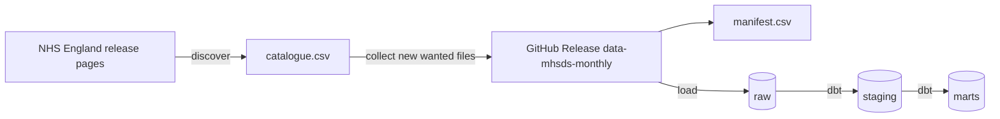

# How the data pipeline works

This page explains, step by step, how NHS England's files become tables that models and dashboards can use. It grows with each part of Phase 1.

## The big picture

## Step 1, discover

The code reads the [series page](https://digital.nhs.uk/data-and-information/publications/statistical/mental-health-services-monthly-statistics), finds every release page from 2022 onwards, and reads every download card on each page. A download card is the box on the page that holds one file, its title, its type and its size.

Each card title is then classified into four things.

| Field | Example | How it is found |
|---|---|---|
| kind | `main`, `oaps`, `referral_spells`, `dq_coverage`, `dq_vodim` | key phrases such as "MHSDS Data File" or "Out of Area Placements" |
| version | `final`, `performance`, `provisional` | "End of Year Final", "Performance", "Provisional" (and the real misspelling "Provsional") |
| reporting month | `2025-08` | the first month named, or the last month for files that cover a range |
| revision | `1`, `2`, `4` | "V4" in the title or "_v2" in the file name |

The rules were written against all 1,426 card titles published from 2022 to 2026, and the tests use real titles. The result is `catalogue.csv`, one row per file, including the files the pipeline does not want and the reason why.

## Step 2, collect

Every wanted file whose web address is not already in the manifest is downloaded, with a one second pause between requests to be polite to NHS England's servers. Each file is

1. checksummed with SHA-256, so any later change can be detected
2. gzipped if it is a CSV, which shrinks older uncompressed files by about ten times
3. given an asset name such as `mhsds__main__2025-08__final__r1__3f2a9c1d0b.zip`
4. added as a row in `manifest.csv`

The wanted kinds and versions are set in [`config/sources.yaml`](../../config/sources.yaml). Today they are the main data file, out of area placements, referral spells and the two data quality files, in both End of Year Final and Performance versions.

## Step 3, publish

The `Ingest MHSDS` GitHub Actions workflow runs every Friday morning and can also be run by hand. It uploads new files, the manifest and the catalogue to the [`data-mhsds-monthly`](https://github.com/nbennwankwo/MentalScape-2.0/releases/tag/data-mhsds-monthly) release ([ADR 0009](../adr/0009-raw-files-in-github-release-assets.md)). On a pull request it does a trial run of two files and publishes nothing.

## Choosing one file per month

Most months now have two versions of each file. The rule in [ADR 0003](../adr/0003-time-window-and-release-versions.md) is applied by `preferred_files` in `src/mentalscape/ingest/manifest.py`.

1. End of Year Final beats Performance, which beats Provisional.
2. Within a version, the highest revision wins.
3. If there is still a tie, the most recent download wins.

The raw layer keeps every version. Only the choice of which one to use is made here.
