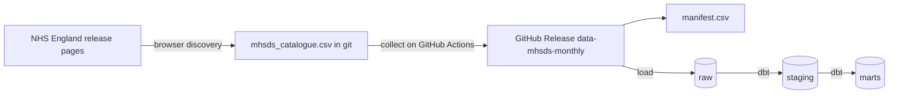

# How the data pipeline works

This page explains, step by step, how NHS England's files become tables that models and dashboards can use. It grows with each part of Phase 1.

## The big picture

## Step 1, discover

NHS England's release pages challenge cloud servers with a bot check, while its file server does not. So discovery happens in a normal browser and collection happens on GitHub Actions ([ADR 0011](../adr/0011-split-discovery-from-collection.md)).

**How to refresh the catalogue**, about once a month after NHS England publishes a new release.

1. Open the [series page](https://digital.nhs.uk/data-and-information/publications/statistical/mental-health-services-monthly-statistics) in a browser.
2. Run [`tools/discover_in_browser.js`](../../tools/discover_in_browser.js) in the browser's developer console. It reads every release page from 2022 onwards and saves `mhsds_cards.json`.
3. Run `uv run python -m mentalscape.ingest.mhsds classify --cards mhsds_cards.json`.
4. Open a pull request with the updated `data/reference/mhsds_catalogue.csv`. Once it is merged, collection starts by itself.

A download card is the box on a release page that holds one file, its title, its type and its size. Each card title is classified into four things.

| Field | Example | How it is found |
|---|---|---|
| kind | `main`, `oaps`, `referral_spells`, `dq_coverage`, `dq_vodim` | key phrases such as "MHSDS Data File" or "Out of Area Placements" |
| version | `final`, `performance`, `provisional` | "End of Year Final", "Performance", "Provisional" (and the real misspelling "Provsional") |
| reporting month | `2025-08` | the first month named, or the last month for files that cover a range |
| revision | `1`, `2`, `4` | "V4" in the title or "_v2" in the file name |

The rules were written against all 1,426 card titles published from 2022 to 2026, and the tests use real titles. NHS England's card titles occasionally carry a typo. When the title's month disagrees with both the page and the file name, and those two agree, the page and file name win and the `note` column records the correction. Four such typos were found in October 2026.

The result is [`data/reference/mhsds_catalogue.csv`](../../data/reference/mhsds_catalogue.csv), one row per file, including the files the pipeline does not want and the reason why. Because it is committed to git, every change NHS England makes to its releases shows up as a reviewable diff.

## Step 2, collect

Every wanted file in the catalogue whose web address is not already in the manifest is downloaded from `files.digital.nhs.uk`, with a one second pause between requests to be polite to NHS England's servers. Each file is

1. checksummed with SHA-256, so any later change can be detected
2. gzipped if it is a CSV, which shrinks older uncompressed files by about ten times
3. given an asset name such as `mhsds__main__2025-08__final__r1__3f2a9c1d0b.zip`
4. added as a row in `manifest.csv`

The wanted kinds and versions are set in [`config/sources.yaml`](../../config/sources.yaml). Today they are the main data file, out of area placements, referral spells and the two data quality files, in both End of Year Final and Performance versions.

## Step 3, publish

The `Ingest MHSDS` GitHub Actions workflow runs every Friday morning and can also be run by hand. It runs whenever the catalogue changes on `main`, and its weekly run also fails if the catalogue is more than three months behind, as a reminder to refresh it. It uploads new files, the manifest and the catalogue to the [`data-mhsds-monthly`](https://github.com/nbennwankwo/MentalScape-2.0/releases/tag/data-mhsds-monthly) release ([ADR 0009](../adr/0009-raw-files-in-github-release-assets.md)). On a pull request it does a trial run of two files and publishes nothing.

## Choosing one file per month

Most months now have two versions of each file. The rule in [ADR 0003](../adr/0003-time-window-and-release-versions.md) is applied by `preferred_files` in `src/mentalscape/ingest/manifest.py`.

1. End of Year Final beats Performance, which beats Provisional.
2. Within a version, the highest revision wins.
3. If there is still a tie, the most recent download wins.

The raw layer keeps every version. Only the choice of which one to use is made here.
